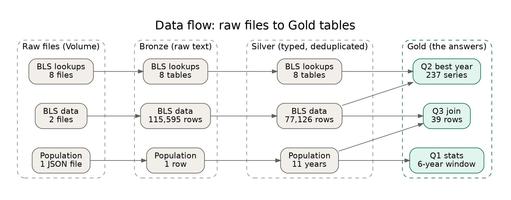
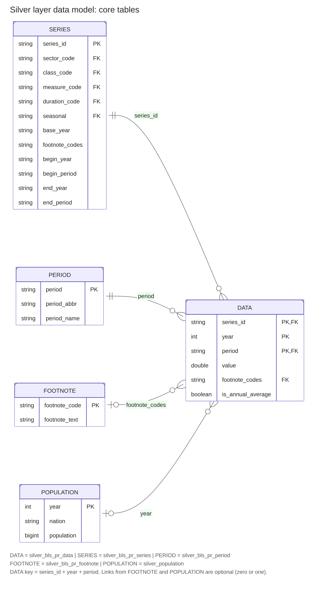
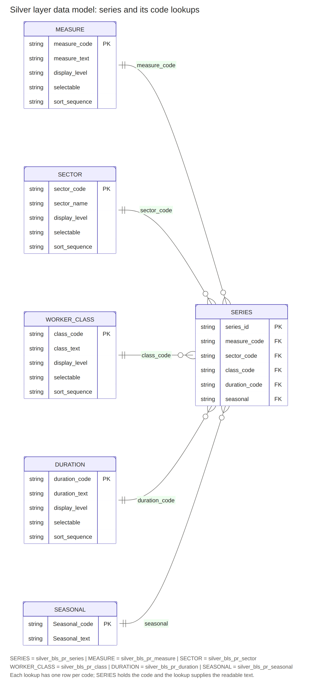
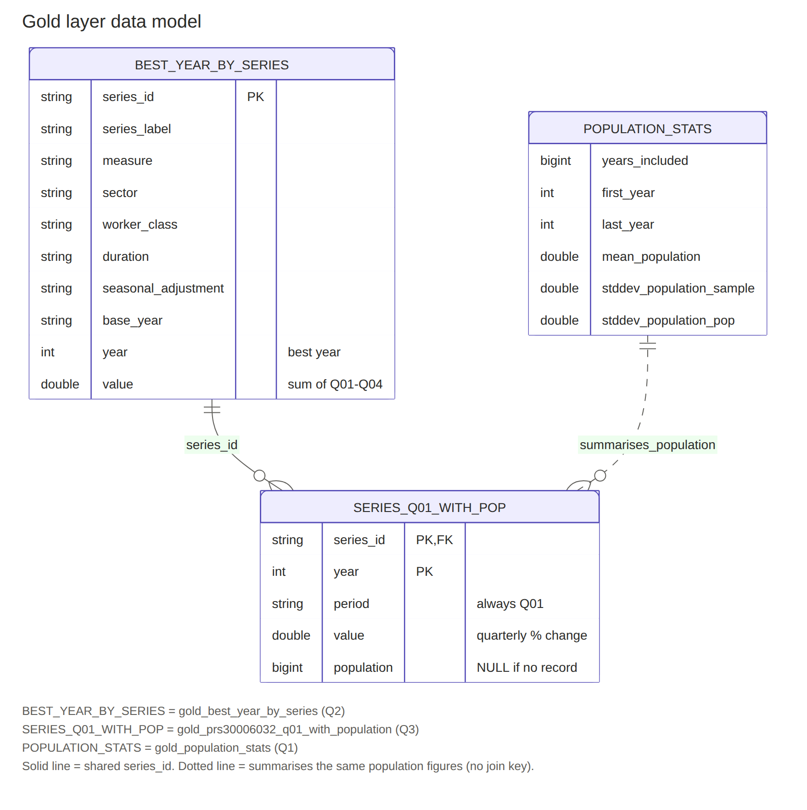

# PROCESS.md

Rearc Data Quest (Databricks edition): BLS productivity time series + DataUSA population.

## Repository layout

```
├── README.md
├── PROCESS.md
├── databricks.yml                # Asset Bundle: pipeline + orchestration job (bonus)
├── 01_ingest_sources.py          # Step 1: notebook, incremental sync into a Unity Catalog Volume
├── pipeline/                     # Step 2: Spark Declarative Pipeline source files
│   ├── bronze.py
│   ├── silver.py
│   └── gold.sql
├── notebooks/gold_pyspark_check.py   # PySpark alternative for the Gold logic + cross-check
├── notebooks/verification_report.py  # reproduces every check/number in this document; export with results
├── diagrams/                     # data flow and data model diagrams (PNG + SVG)
├── output/                       # evidence from my Databricks run
│   ├── verification_report.html  # exported results of notebooks/verification_report.py (19 checks)
│   └── screenshots/              # screenshots of the pipeline and tables in Databricks
└── bonus/
    ├── genie_space_setup.md      # Genie space configuration (instructions, examples, sample questions)
    └── access_controls.sql       # read-only analyst grants on the Gold layer
```

Run order: `01_ingest_sources.py` (set the `contact` widget to your own name and email), then run the pipeline,
then `gold_pyspark_check.py`.

---

## 1. Architecture

### Step 1: ingestion (re-runnable, idempotent)

- **Everything in the BLS `pr` folder is pulled, not just the data file.** The directory listing is scraped each run, so
  no filenames are hardcoded. New files appear automatically.
- **Manifest-driven sync.** `_state/manifest.json` in the Volume records size, last-modified, hash and landing path
  per file. A re-run with no source changes downloads nothing (one listing request).
- **Changed files land as new immutable versions** at `bls/pr/<file>/v=<last_modified>/<file>`; nothing is overwritten.
  Reason: Auto Loader ignores files that are overwritten in place by default, and versioned landing keeps history.
  The consequence is that Silver must pick the right version (see below).
- **Removed files** are flagged `removed_at` in the manifest; the raw copy is retained, not deleted.
- **Safety guard:** a listing that parses to zero files aborts the run, so a changed page layout or an outage can't be
  mistaken for "everything was removed".
- **403 handling:** BLS requires contact information in the `User-Agent` header ([BLS data access policy](https://www.bls.gov/bls/pss.htm)).
  The notebook refuses to run unless the `contact` widget holds an email address other than the `example.com` placeholder. Requests use exponential backoff on 429/5xx but fail
  fast on 401/403/404, since retrying a policy block is pointless.
- **Population API:** the response is hashed in canonical form and a new snapshot is landed only when the content
  changes.
- Downloads go to local temp, are checked, then copied into the Volume; the manifest is checkpointed after every file,
  so a mid-run failure resumes cleanly.

### Step 2: Spark Declarative Pipeline (Bronze → Silver → Gold)

**Bronze** (`bronze.py`): raw, append-only streaming tables over the Volume using Auto Loader.
- All columns are strings; nothing is dropped. Lineage columns on every row: `_source_file`, `_source_version`,
  `_source_modified_at`, `_ingested_at`.
- `_rescued_data` captures anything that doesn't fit the expected structure instead of silently losing it.
- Tables are discovered from the Volume at update time: all `pr.data.*` files go to one table, and each lookup file
  (`pr.series`, `pr.measure`, ...) gets its own table. `pr.txt` and `pr.contacts` are documentation and are skipped.
- Expectations in Bronze are **record-only** (warn): series_id present, 4-digit year, valid period code, nothing
  rescued. Principle: Bronze should never be the reason a row disappears; enforcement belongs in Silver.
- Deliberate small deviation from "pure raw": BLS pads header names with whitespace, so header names are trimmed
  (values are untouched).

**Silver** (`silver.py`): typed, trimmed, deduplicated, enforced.
- Strings trimmed (empty → NULL); `year` and `value` cast with `try_cast` so a bad value becomes NULL, not a failed run.
- **Enforcing expectations (drop):** non-null `series_id`, valid year, valid period format. Warn-only check that `value`
  is numeric, so unparseable values are counted without losing the row.
- **Deduplication in two steps.** First, keep only the newest version of each *source file* (files are full
  replacements, so a row BLS removed must not survive from an older version). Second, because the `pr.data.*` files
  overlap, keep one row per `(series_id, year, period)`, newest version winning.
- Lookup tables keep only the newest snapshot of each file.
- Population: newest API snapshot only, flattened from a JSON string into `year`, `nation`, `population`.
- `is_annual_average` flags BLS annual-summary periods (`M13`, `Q05`, `S03`, `A01`).

**Gold** (`gold.sql`): three tables answering the three questions.
- **SQL is the primary implementation** (materialized views in the pipeline). **PySpark is the documented
  alternative** in `gold_pyspark_check.py`, which recomputes all three answers with the DataFrame API and asserts
  row-for-row equality with the SQL tables.
- Why SQL as primary: the three questions are set-based aggregations and a window/ranking, which read most clearly as
  SQL and are easiest for an analyst to review. PySpark is used for verification and shows the same logic expressed
  through the DataFrame API.

### Data model and lineage

The diagram below shows how each table is built. One row per source runs from the raw files through Bronze and Silver,
and Silver feeds the three Gold answers. The counts are from the verified run.



The Silver tables are modeled below as two diagrams, because ten tables in one picture would be too wide to read. The
first shows the measurements (`DATA`) and what joins to them. The second shows the five code lookups that give each
series its readable labels. `SERIES` appears in both and is the link between them.





The Gold tables are summaries of Silver, so their model is small: Q2 and Q3 share `series_id`, and the Q1 statistics
summarize the same population figures that appear in Q3.



All diagrams are in the `diagrams/` folder. The PNG files are for reading and the SVG files are editable copies.

| File | What it shows |
|---|---|
| `diagrams/lineage` | Data flow from the raw files through Bronze and Silver to the three Gold tables, with row counts |
| `diagrams/silver_core_data_model` | The Silver measurements table and the tables that join to it |
| `diagrams/silver_lookup_data_model` | The Silver series table and its five code lookups |
| `diagrams/gold_data_model` | The three Gold tables and how they relate |

### Screenshots from my Databricks run

These are screenshots of the pipeline's results in my Databricks workspace. They are in `output/screenshots/`.

| File | What it shows |
|---|---|
| [`databricks_pipeline_graph.png`](output/screenshots/databricks_pipeline_graph.png) | The pipeline graph in Databricks: ten rows (nine BLS files and the population file), each running from the raw Volume through a Bronze and a Silver table into the three Gold tables, with every table showing a green check. Databricks shortens the table names here; the full names are in the Unity Catalog screenshots below |
| [`uc_tables_part1.png`](output/screenshots/uc_tables_part1.png) | Unity Catalog view of the `rearc_quest` schema: 23 tables in total, this image lists the first 20 (Bronze, Gold and most of Silver) |
| [`uc_tables_part2.png`](output/screenshots/uc_tables_part2.png) | The last three tables: `silver_bls_pr_sector`, `silver_bls_pr_series` and `silver_population` |
| [`uc_volume_raw.png`](output/screenshots/uc_volume_raw.png) | The raw Volume `/Volumes/workspace/rearc_quest/raw` with its `_state`, `bls` and `population` folders, where ingestion lands the data |
| [`bundle_run.png`](output/screenshots/bundle_run.png) | The Asset Bundle job run: `ingest`, `transform` and `verify_gold` all succeeded |
| [`genie_agent_setup.png`](output/screenshots/genie_agent_setup.png) | The Genie space "US Productivity and Population Explorer": description with capabilities and limitations, the six sample questions, and the configuration panel |
| [`genie_agent_response.png`](output/screenshots/genie_agent_response.png) | Genie's answer to the manufacturing hours vs population question, with a chart that shows every year since 2013 and leaves gaps in the population line where there is no record |

The exported results of the report notebook are in [`output/verification_report.html`](output/verification_report.html).

### Results and how I verified them

`notebooks/verification_report.py` reproduces every number and check below in one notebook (row counts, duplicate
analysis, Gold results, population years across layers, grants) and ends with a PASS/FAIL summary. I attach its
exported output as `output/verification_report.html` (19 checks, all passing).

| Question | Result | Verification |
|---|---|---|
| Q1: mean / std of US population, 2013–2018 | mean **322,069,808**; sample std **4,158,441**; population std 3,796,120 | Mean checked by hand against the six yearly values; ratio of the two std values is √(6/5) as expected for n = 6 |
| Q2: best year per series | 237 series, one row each, all labeled | Row/distinct/unlabeled counts (237 / 237 / 0); hand-checked `PRS30006011` (best year 2022, total 16.4, 4 quarters); winning years reviewed for economic plausibility |
| Q3: `PRS30006032` / `Q01` with population | one row per year, population NULL where unavailable | Spot-checked 2013 = 316,128,839 against the raw API output |

SQL and PySpark outputs matched on all three (`All Gold implementations agree.`).

**Data-quality numbers (hand-built schema, from-scratch run)**

| Measure | Result |
|---|---|
| Bronze rows (all `pr.data.*` files) | 115,595 |
| Distinct `(series_id, year, period)` keys | 77,126 |
| Silver rows / distinct keys | 77,126 / 77,126 (no duplicates remain) |
| Silver rows with a NULL `value` | 0 |
| Rows removed by deduplication | 38,469 (about a third of Bronze) |

I investigated the duplicates instead of assuming they were harmless:
- The BLS folder has two data files, `pr.data.0.Current` and `pr.data.1.AllData`. Of the 77,126 keys, 38,657 appear
  only in `AllData` and 38,469 appear in both. No key appears only in `Current`, so `Current` is entirely contained in
  `AllData`, and the 38,469 duplicate rows are exactly the keys the two files share (38,657 + 2 × 38,469 = 115,595).
- No key has conflicting values across the two files (0 keys with more than one distinct `value`), and a side-by-side
  look at examples (for instance `PRS30006011` in 1995–1996) shows identical values in both. The duplicates are exact
  repeats, so deduplication removes rows without changing any number.
- `pr.period` lists only `Q01`–`Q05`, and `Q05` is described as "Annual Average" (checked in the lookup table, not
  assumed). Q2 therefore sums only `Q01`–`Q04`. The other annual-summary codes Silver flags (`M13`, `S03`, `A01`) do not
  occur in this dataset and are there defensively.
- Silver has exactly as many rows as Bronze has distinct keys, so the enforcing expectations dropped no rows on this
  data. The pipeline event log confirms it: for `silver_bls_pr_data`, all 77,126 records passed each of the four
  rules (`series_id_not_null`, `year_is_valid`, `period_is_valid`, `value_is_numeric`), with 0 failed and 0 dropped.
  For `bronze_bls_pr_data`, all 115,595 records passed each of its four record-only rules (`series_id_present`,
  `year_is_4_digits`, `period_is_valid`, `no_rescued_data`), with 0 failed and 0 dropped.

Because `Current` is a subset of `AllData`, ingesting only `AllData` would give the same Silver result today. I ingest
every `pr.data.*` file and deduplicate on the key anyway, so the pipeline stays correct if BLS publishes new data in
one file before the other or adds another data file.

**Choices worth knowing about**
- **Standard deviation:** the quest doesn't say sample or population. Both are in the table; I treat six annual
  observations as a sample and report the *sample* value as the headline.
- **Q2 sums only Q01–Q04.** `Q05` is BLS's annual-average row and would double-count the year.
- **Q2 labels** come from `pr.series` joined to the measure, sector, class, duration and seasonal lookups (LEFT JOINs,
  so a series is kept even if a code lacks a lookup row).
- **Q3 uses a LEFT JOIN**, as the quest says "where available". Population is NULL for 2020, 2025 and 2026 and for
  all years before 2013. The API returns no record for those years: I confirmed in the raw Bronze data that 2020 is
  absent (the source has 2013–2019 and 2021–2024), so Silver and Gold are not losing it. The pipeline surfaces the gap
  as NULL instead of interpolating or filling a value, because an invented population figure would be indistinguishable
  from a real one downstream. The Q1 window (2013–2018) is fully populated, so the statistics are unaffected.
  2025 is not expected to be available yet: the population cube appears to be built on ACS 1-year estimates (inferred
  from its name), and the Census Bureau has scheduled the 2025 ACS 1-year release for October 29, 2026 (see the
  Census 2025 data release schedule). Re-running ingestion after the source adds that year is the exact scenario the
  pipeline is designed for: the population hash changes, a new snapshot lands, Silver uses the newest snapshot, and
  Gold picks up the new year without code changes.

---

## 2. Trade-offs: what I'd do differently for a real client

- **Schema drift.** Bronze keeps everything as strings and captures mismatches in `_rescued_data`, and the expectations
  act as a tripwire. For a client I'd add alerting on expectation failure rates and a documented process for handling
  new or renamed BLS columns, instead of relying on someone looking at the pipeline graph.
- **Orchestration and concurrency.** The ingestion manifest is a JSON file; two simultaneous runs could race. In
  production I'd store it in a Delta table and run ingestion as a Job with max concurrency 1, scheduled, with retries
  and failure notifications.
- **Source removals in Silver.** A *row* removed from a newer version of a file is handled, because Silver keeps only
  the newest version of each source file. A whole *file* removed at the source is flagged `removed_at` in the manifest
  and its raw copy is kept, but Silver and Gold do not read the manifest, so that file's last version keeps feeding
  them (for a lookup file, its last snapshot stays). On this data the practical impact today is none for
  `pr.data.0.Current`, since all of its keys are also in `pr.data.1.AllData`; if `AllData` were removed, its last
  version would stay in the results. I left this as is on purpose, because the right behavior is a business decision,
  not a technical one. With a real client I would first confirm with the data owner what a removal means (the file was
  superseded and the last data is still valid; it was withdrawn because it was wrong and must disappear from reports;
  or a retention rule applies), and then implement that approach. Options include excluding flagged files in Silver by
  reading the manifest, keeping the last version but raising an alert, or archiving after a retention period.
- **Completeness in Q2.** The best year is the largest sum, so an incomplete year can't win against a complete one. No
  series has 2026 as its best year, which is a symptom of this (2026 has fewer than four published quarters). The
  quest defines the metric literally; a production report would restrict to complete years or compare averages, and
  would be agreed with the stakeholder.
- **Volume and cost.** This data is tiny (about 115,000 Bronze rows and 77,000 Silver rows). Silver and Gold are recomputed materialized
  views, which is fine here. At larger volumes I'd move Silver deduplication to incremental processing (for example
  `APPLY CHANGES`/CDC-style merges keyed on the business key) and partition or cluster Gold by series.
- **Access control.** Implemented as read-only Unity Catalog grants for an analyst group on the three Gold tables, with
  nothing granted on Bronze, Silver or the raw Volume (see section 4). For a real client I'd publish Gold to its own
  schema, so analysts never hold `USE SCHEMA` on the schema that contains raw data, and run the pipeline as a service
  principal instead of a personal user.
- **Monitoring.** Use pipeline event logs and expectation metrics for data-quality trends, row-count anomaly checks
  between runs, and freshness alerts if the BLS ingestion hasn't succeeded in N days.
- **Politeness to the source.** BLS asks bots to identify themselves; I send a contact `User-Agent` and make one
  listing request plus only the downloads that changed. A client deployment should also respect BLS request-rate
  guidance.
- **Dynamic table discovery.** Flexible (new lookup files appear automatically) but less explicit than one reviewed
  definition per table; some governance teams would prefer the explicit version.

---

## 3. Retrospective: what was hardest

1. **Padded whitespace in BLS files.** Header names like `series_id        ` didn't match my explicit schema, so
   Spark silently sent those columns to `_rescued_data`, leaving `series_id` and `value` NULL on every row. The
   Bronze expectations panel showed 100% failure on exactly those rules, which is what exposed it. Fix: infer header
   names and trim them. Lesson: the rescued-data column and the expectations earned their keep.
2. **Auto Loader reads JSON columns as strings by default.** The population `data` array arrived as a JSON string, so
   `explode` failed. Fix: parse it with `from_json` into an array of maps.
3. **Population in scientific notation as text** (`"3.16128839E8"`). A direct cast to an integer returned NULL, the
   expectation dropped every row, and Silver came out empty. Fix: cast through DOUBLE, then round.
4. **Runtime/API differences for pipelines.** I hit import and decorator errors (`pyspark.pipelines` missing
   expectation decorators, `dlt` not importable) before getting the pipeline running; the final code uses
   `import dlt as dp`, and the first failures were partly caused by running the file outside a pipeline. What I took from it: pipeline source files only work when they run as part of a pipeline. Run as a regular
   notebook they fail with import errors and a missing pipeline setting (`raw_path`), which is what I first saw. Adding
   the files to a pipeline and running it from there fixed that, and I made the `raw_path` lookup fall back to a default
   so the files still work when the setting is absent.
5. **Re-run semantics.** Designing for "added, changed, or removed" data without reprocessing needed the versioned
   landing, the per-file latest-version rule in Silver, and the removal flag; this took the most design thought.

---

## 4. Bonus items

I took three of the suggested bonus directions: a Genie space, read-only access controls, and deployment with an
Asset Bundle.

### 4.1 Genie space on the Gold layer

I built a Genie space so a non-technical stakeholder can answer questions about the data without writing SQL. The full
configuration text is in `bonus/genie_space_setup.md`.

- **Scope:** only the three Gold tables are attached (not Bronze or Silver), so users can't wander into raw or
  partially cleaned data.
- **Instructions that encode the data's quirks.** Without guidance, a natural-language tool gives confident but wrong
  answers on this dataset, so the instructions say:
  - Compare like with like: `Index (2017=100)` series are levels and `% Change ...` series are growth rates, so
    they must not be ranked against each other.
  - `value` is always the sum of the four quarterly values in the best year: a sum of percentages for percent-change
    series, and a sum of four index levels (about four times the average level) for index series. It is a ranking
    number for picking a best year, never an index level, a growth rate or cumulative growth.
  - No series peaks in 2026 because the year is incomplete.
  - Missing population years are "not available", never zero, and are never estimated.
  - Use the sample standard deviation unless asked otherwise.
  - Keep every year in tables and charts (population blank where missing), and describe only what the numbers show:
    no invented causes and no correlation claims that were not computed.
- **Five example SQL queries** teach Genie the filtering and join patterns (top index series by best-year value, series
  peaking by year and measure, one measure across sectors, population statistics, manufacturing hours vs population).
  I checked the first one against the Q2 output: its top rows (for example "Profits | Nonfinancial Corporations |
  Employees | Index (2017=100)") match the values verified earlier.
- **Description and six sample questions** are written around real questions a stakeholder would ask. I corrected the
  auto-generated description, which said population data was limited to 2013–2018 (only the statistics table is;
  the join table covers 2013–2024 except 2020) and implied time-series trends that the Gold tables don't hold.
- **Value matching:** the Sources tab shows entity matching and format assistance already enabled on the text columns
  (`measure`, `sector`, `worker_class`, `duration` and so on), so users can type "profits" or "manufacturing" and have
  it matched to the real values.
  I also added descriptions to some of the columns on the Gold tables, so Genie knows what each field means.
- **Testing.** I asked Genie three of the sample questions and checked two answers against my Gold tables.
  - *Business index series.* The five series and values matched to two decimals (nonlabor payments 661.82,
    value-added output 633.51, labor compensation 611.54, hourly compensation 581.33, unit nonlabor payments 531.85,
    all 2025), and it kept to the Business sector and index series, with no "Nonfarm Business" series. Its explanation,
    though, called the values "cumulative growth since the 2017 base year," which is wrong: each value is the sum of
    four quarterly index levels. The original rule covered only percent-change series, so I extended it to index series.
  - *Manufacturing hours vs population.* Every figure was right: the +5.3% peak in 2022, the 316.1 million to 340.1
    million rise (+7.6%), and population missing for 2020, 2025 and 2026. Two weaknesses showed up. The chart plotted
    only years that have population, so 2020 (−7.0%, the steepest decline, which the text itself cites) was missing
    from the chart. And it attributed the swings to the pandemic and said there was "no clear correlation" without the
    data supporting either claim. I added instructions to keep every year in tables and charts, to describe only what
    the numbers show, and not to claim a correlation unless it is computed.
  - *Re-test after the instruction changes.* The pandemic explanation and the "no clear correlation" line were gone,
    but two problems remained. The chart still left out 2020, and the answer now said the series change
    "independently of population levels," which is still a claim nobody computed. The chart problem traced back to my
    own fifth example query, which filtered `WHERE population IS NOT NULL`: Genie copies example queries more
    faithfully than it follows written instructions. I changed that example to keep every year since 2013, and
    tightened the rule to also rule out claims of independence or no relationship.
  - *Final result.* After the example change, the chart shows 2020 with its −7.0% bar, the population line breaks
    where there is no record (2020, 2025, 2026), and every figure in the text matches my Gold table. One weakness
    remains, visible in the screenshot: the closing paragraph still says "no apparent correlation exists" and that
    hours "varied independently of population growth," claims nobody computed. It also says population "continued its
    steady upward trend" through the 2020 decline, although the population record for 2020 is missing. I treat that as
    a known limit of natural-language answers. Instructions reduce unsupported statements but do not remove them, so
    a real deployment would keep a set of benchmark questions and review the answers.

**What I'd add next for a real client:** a benchmark set of questions with expected SQL that is re-run after every
instruction change, and regular review of the questions users actually ask. Access to the space and its tables is
covered in 4.2.

### 4.2 Unity Catalog access controls

`bonus/access_controls.sql` grants a read-only analyst group the minimum it needs and nothing more:

- `USE CATALOG` and `USE SCHEMA` (traversal only), plus `SELECT` on **only the three Gold tables**.
- No grants on any `bronze_*` or `silver_*` table or on the raw Volume, so analysts cannot see unvetted data or the
  landed files. Unity Catalog has no DENY; access is none unless explicitly granted, so leaving things ungranted is the
  control.
- No `CREATE` or `MODIFY` anywhere. The pipeline owner owns and writes the tables.
- The file includes `SHOW GRANTS` checks and a negative test (a read of Bronze that should fail with a permission
  error). It also notes the extras an analyst needs in practice: `CAN USE` on a serverless or Pro SQL warehouse
  (materialized views need one) and `CAN RUN` on the Genie space.

**What I ran and verified:** I created an `analysts` group and applied the grants in `bonus/access_controls.sql`.
Querying the Unity Catalog information schema for that grantee returns exactly five privileges: `USE CATALOG` on
`workspace`, `USE SCHEMA` on `rearc_quest`, and `SELECT` on the three Gold tables, with nothing on any `bronze_*` or
`silver_*` table. The group has no members in my single-user workspace, so I could not run the negative test as a
second user (a Bronze read that should fail); that part is verified only by the absence of grants.

**Trade-off I'd change for a real client:** Gold lives in the same schema as Bronze and Silver here to keep the
pipeline simple. A separate Gold schema would let analysts have no access to the raw-data schema at all.

### 4.3 Deployment with a Databricks Asset Bundle

`databricks.yml` defines the project as code so it can be deployed without clicking through the UI:

- **Pipeline resource:** serverless, publishing to the configured catalog and schema, with the three pipeline files as
  sources and `raw_path` passed as pipeline configuration.
- **Job resource** `refresh_job` with three tasks in order: `ingest` (the ingestion notebook), `transform` (the
  pipeline) and `verify_gold` (the PySpark cross-check, which fails the job if the SQL and PySpark answers disagree).
  That gives a scheduled, observable run with a data-quality gate at the end.
- **Safe-by-default settings:** `max_concurrent_runs: 1`, because the ingestion manifest is not safe for concurrent
  runs, and the schedule is deployed paused so it is switched on deliberately.
- **Variables** for catalog, schema, volume and the BLS contact string; `contact` has no default on purpose so nobody
  deploys with a placeholder.
- Only a `dev` target is defined. A real `prod` target would use production mode with a service principal, a shared
  workspace path and explicit permissions.

**What I ran and verified:** I installed the Databricks CLI, deployed the bundle to the `dev` target with
`databricks bundle deploy` (10 files uploaded, the pipeline and the job created) and started the job with
`databricks bundle run`. On a first run into empty tables, all three tasks succeeded in order: `ingest` (about 51
seconds), `transform` (the pipeline, about 3 minutes) and `verify_gold` (about 50 seconds). `verify_gold` passing means
the PySpark cross-check ended without its assertion failing, so the SQL and PySpark Gold results agreed on the
freshly built tables. I deployed the bundle into its own schema, `rearc_quest_bundle`, separate from the `rearc_quest` schema I built by
hand, so the two builds could not interfere and each could be checked independently.

---

## 5. AI usage

I used Claude as a pair-programming and reference tool throughout, and I want to be specific about who did what.

**What Claude drafted:** the first versions of the ingestion notebook, the Bronze/Silver/Gold code, the PySpark
cross-check notebook, the Genie space configuration text, and the first drafts of this document and the README.

**What I did:**
- **Ran everything in Databricks and debugged it from real output.** The first versions did not work. Most of the
  bugs below only appeared when I ran the pipeline and looked at the expectation panels and error messages, and I
  sent those back to iterate:
  - Bronze expectations showed 100% failures on `series_id` and `value`; I queried `_rescued_data` and confirmed the
    padded BLS header names were the cause, after which the header handling was changed.
  - `silver_population` failed on `explode` because the JSON `data` column was a string; after that it came out empty
    until I queried the raw records and the cast of scientific-notation population text was fixed.
  - The pipeline files failed with import and decorator errors until they were running as pipeline source with the
    right module.
- **Verified the results independently instead of trusting the generated code.** I hand-checked a series total
  (`PRS30006011`, best year 2022), checked the Q1 mean against the six yearly values, reviewed the Q2 labels and
  winning years for plausibility, and ran the SQL-vs-PySpark equality check on all three answers.
- **Questioned design choices and data gaps.** I asked whether the Bronze pattern was standard practice, what
  `footnote_codes` and `_rescued_data` were for, and why 2020 and 2025 had no population. I confirmed in the raw
  Bronze data that 2020 is absent from the source, and checked every year across Bronze, Silver and Gold.
- **Tested from a clean slate.** I cleared the schema and re-ran ingestion and the pipeline from scratch, and later
  deployed the whole flow with the bundle into a separate schema, where it ran end to end again.
- **Made the final calls** on scope (SQL as the primary Gold implementation, adding the Genie space) and on what to
  keep or change in the generated code.

**Code review.** Once everything worked, I reviewed the code again. That review led to three decisions. I documented
the removed-file behavior as a trade-off to confirm with a real client instead of choosing a rule myself. I had
comments added to every file, and checked that only comments changed. And I made the BLS contact requirement explicit
in the notebook, its error message and the README. The code changes themselves were made by Claude in response to the
problems I found and the requests I made; where I found weaknesses, I listed them in section 2 instead of hiding them.
